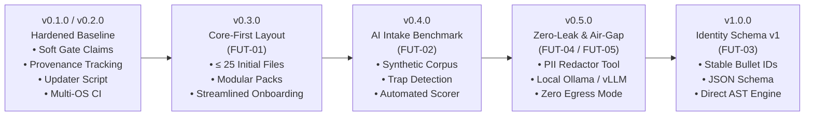

# Pramedha Career Template — Architecture & System Roadmap

> **Status:** Active Architectural Blueprint  
> **Current Version:** `v0.1.0` (Hardened Baseline)  
> **Target Release:** `v0.2.0` (Owner Release Milestone) → `v1.0.0` (Identity Schema v1)  
> **Source Documents:** Derived from zero-trust audit findings (`analysis.md`, `changes.md`, and empirical audits).

---

## 🗺️ Roadmap Overview

The Pramedha Career Template is designed as an autonomous, evidence-backed personal career database that replaces scattered, inflated resumes with a verified source of truth.

This roadmap captures the engineering milestones, architectural transitions, and governance actions required to progress from the hardened `v0.1.0` release to a modular, schema-driven, zero-leak Career Operating System (`v1.0.0`).



---

## 🚀 Immediate Next Step: Release v0.2.0 Packaging (Owner Actions)

The code-level audit remediation is 100% complete with 92 passing automated tests and end-to-end RenderCV PDF compilation. The remaining items for the official `v0.2.0` release require owner governance credentials and external platform actions:

| Action ID | Scope | Ownership | Description & Verification |
|:---------:|-------|:---------:|----------------------------|
| **OA-1** | PyPI Namespace | Owner | **Defensive Namespace Registration:** Register the package name `pramedha` on [PyPI](https://pypi.org) under the owner account to defend against dependency-confusion or typosquatting attacks. *(Note: Codebase is safe under Decision D5=A with all unreleased CLI references removed).* |
| **OA-2** | Repository Positioning | Owner | **GitHub Repository Metadata:** Update the repository description on GitHub.com: drop *"or as the data layer for Pramedha — the AI-first career platform"* or append `(platform in development)`. |
| **OA-3** | Release Engineering | Owner | **Version Bump & Tagging:**<br/>1. Bump `template.version` in `.pramedha/manifest.yaml` to `0.2.0`.<br/>2. Finalize `[0.2.0]` release notes in `.github/CHANGELOG.md` including migration notes, virtualenv setup, and updater bootstrap.<br/>3. Verify sample PDF at `docs/sample/alex-chen-backend.pdf` (already compiled).<br/>4. Create annotated git tag `git tag -a v0.2.0 -m "Release v0.2.0"` and publish a GitHub Release. |
| **OA-4** | Live CI & Windows Verification | Owner | **External Verification Matrix:**<br/>1. Verify that `template-checks` GitHub Actions job passes across `ubuntu-latest`, `windows-latest`, and `macos-latest`.<br/>2. Verify PowerShell 5.1 and `cmd.exe` execution on a stock Windows 11 machine.<br/>3. Push a throwaway public fork to confirm that the `privacy-guard` workflow triggers and blocks public publication. |

---

## 📦 Milestone v0.3.0: Core-First Layout & Progressive Disclosure (`FUT-01`)

- **Objective:** Drastically lower onboarding cognitive load for first-time users by minimizing initial file footprint.
- **Effort:** Large (L)
- **Status:** Architecture Designed; Ready for Prototyping

### The Problem
A fresh clone currently contains 50+ files outside the engine directories (`.pramedha/`, `.github/`, `tools/`). Over 21 of these files are contextual templates (`stories/`, `strategy/`, `personal/`, `journal/`) that are unnecessary during day-one setup and initial resume generation.

### Architecture & Implementation
1. **Core Distribution Default:**
   - The default template clone will contain **$\le 25$ initial files** outside engine and tests:
     - Root: `config.yaml`, `README.md`, `GETTING_STARTED.md`, `VISION.md`, `AGENTS.md`
     - Identity: `identity/*.yaml` (Authoritative fact layer)
     - Evidence: `data-corpus/` (Raw evidence folders)
     - Resume: `tools/resume/` (Decoupled compiler)
2. **Modular Context Packs (`extras/` or Agent-Summoned):**
   - Package contextual files into on-demand modules:
     - `pack-interview-prep`: Behavioral STAR story bank (`stories/`)
     - `pack-job-search`: Target roles, application tracker, financial models (`strategy/`)
     - `pack-personal`: Private reflections, career narrative, form-fill cheatsheets (`personal/`)
     - `pack-journal`: Shipped wins, work logs, learning logs (`journal/`)
3. **On-Demand Agent Unpacking:**
   - AI assistants unpack relevant modules when the user transitions to specific career phases (e.g., "Prepare for my Google interview" summons `pack-interview-prep`).
4. **Outcome Metric:**
   - First-run documentation fits entirely on a single screen without scrolling; newcomer setup time reduced from 30 minutes to $\le 10$ minutes.

---

## 🧪 Milestone v0.4.0: AI Intake Benchmark & Evaluation Harness (`FUT-02`)

- **Objective:** Empirically measure, score, and guarantee AI assistant accuracy during automated career data extraction.
- **Effort:** Medium (M)
- **Status:** Specification Complete

### The Problem
The headline feature—"Let AI fill everything from `data-corpus/`"—currently relies on prompt instructions without automated regression evaluation. AI coding assistants (Claude, Gemini, GPT, DeepSeek) vary in instruction following, date extraction accuracy, and hallucination tendencies.

### Architecture & Implementation
1. **Synthetic Career Corpus (`data-corpus/synthetic/`):**
   - A realistic, ground-truth career dataset for a synthetic persona (Alex Chen / Priya Sharma) containing intentional traps:
     - Two conflicting job dates between a resume and a LinkedIn export
     - An impressive metric with zero corroborating evidence in the dump
     - An employer-confidential document (internal architecture RFC)
     - A government ID document (passport / SSN / Aadhaar)
2. **Automated Evaluation Engine (`tests/eval/score_fill.py`):**
   - Compares the AI assistant's generated `identity/*.yaml` and `claims-and-evidence.md` against an oracle key.
   - **Scoring Dimensions:**
     - **Hallucination Rate:** Zero unevidenced metrics or invented skills.
     - **Confidentiality Filtering:** Zero confidential documents ingested; internal files listed under "Files skipped".
     - **PII Scrubbing:** Zero government ID numbers extracted into identity facts.
     - **Conflict Detection:** Date discrepancies logged in `claims-and-evidence.md` Claim Debt Queue.
3. **Outcome Metric:**
   - An objective, published accuracy benchmark table across major LLM models; automated release gate requiring 100% compliance on anti-inflation and privacy preservation.

---

## 🛡️ Milestone v0.5.0: Zero-Leak Redaction & Air-Gapped Mode (`FUT-04` & `FUT-05`)

- **Objective:** Provide enterprise-grade confidentiality guarantees and completely offline workflows for defense, healthcare, government, and strict-NDA professionals.
- **Effort:** Medium (M)
- **Status:** Conceptual Design Complete

### Architecture & Implementation
1. **Local Pre-Ingestion Redaction Utility (`tools/redact.py` — `FUT-04`):**
   - A zero-dependency Python utility run locally before AI ingestion:
     - Regex & pattern detection for sensitive identifiers: SSN, Passport numbers, national IDs, bank accounts, home addresses, phone numbers.
     - Redacts employer-confidential keywords, internal project codenames, and unreleased client names using configurable pseudonym mappings.
2. **Air-Gapped & Local LLM Protocol (`FUT-05`):**
   - Native support and prompt templates tailored for local models running via **Ollama**, **LM Studio**, or **vLLM** (`mistral-large`, `llama-3.3`, `qwen-2.5-coder`).
   - Dedicated `AGENTS.local.md` instructions optimized for smaller local context windows without compromising extraction thoroughness.
   - Zero token egress: Career data never leaves the candidate's physical machine or private network.

---

## ⚡ Milestone v1.0.0: Identity Schema v1, Stable Bullet IDs & Unified AST (`FUT-03`)

- **Objective:** Eliminate redundant data duplication by establishing `identity/` as the direct, unified Abstract Syntax Tree (AST) for all career outputs.
- **Effort:** Large (L)
- **Status:** Target State Architecture Defined

### The Problem
Currently, career facts in `identity/` are duplicated into `tools/resume/master.yaml` by `sync.py`, requiring provenance pointers (`_source`) and anti-staleness build checks (`CRIT-03`) to prevent divergence.

### Architecture & Implementation
1. **Stable Bullet Identifiers in Identity:**
   - Every bullet in `identity/experience.yaml` receives an immutable unique identifier:
     ```yaml
     experience:
       - company: "Acme Corp"
         position: "Staff Backend Engineer"
         start_date: "2023-01"
         end_date: "present"
         bullets:
           - id: bul_api_fastapi
             text: "Redesigned REST API with async FastAPI handlers, reducing p99 latency by 40% [measured]"
             verification: "✅ VERIFIED — data-corpus/documents/perf-metrics.pdf"
     ```
2. **Official JSON Schema (`schema.json`):**
   - Publish a formal JSON Schema covering all `identity/` structures:
     - Enforces ISO date formats, valid enums, required fields, and verification tag structures.
     - Provides instant autocomplete, real-time validation, and in-editor documentation in VS Code, Cursor, and Neovim via YAML Language Server.
3. **`master.yaml` Re-framed as a Pure Phrasing Overlay:**
   - Resumes no longer copy fact text into `master.yaml`. Instead, `master.yaml` holds only optional phrasing variants keyed by `id`:
     ```yaml
     phrasings:
       bul_api_fastapi:
         concise: "API redesign, 40% faster p99 latency"
         technical: "Migrated monolith REST API to FastAPI with async handlers, dropping p99 latency from 800ms to 480ms"
     ```
4. **Direct AST Compilation:**
   - `assemble.py` compiles directly from `identity/` + phrasing overlays $\rightarrow$ RenderCV YAML.
   - `sync.py` and provenance checks are retired because divergence becomes mathematically impossible.
5. **Outcome Metric:**
   - Zero duplicate text across the repository; editing a metric in `identity/` immediately reflects on the next resume compilation; automated migration script converts legacy v0.1/v0.2 pools seamlessly.

---

## 🌐 Ecosystem & Extended Integration (`FUT-06`)

1. **Two-Way WebAssembly Sync (`rendercv.com`):**
   - Seamless export and import between local Pramedha variants and the official RenderCV WebAssembly browser designer for visual drag-and-drop tweaking.
2. **Domain-Specific Theme Styling Presets:**
   - Curated `design.yaml` configurations matched to industry standards:
     - `engineeringresumes`: Software engineering, DevOps, infrastructure (high density, single column).
     - `classic` / `harvard`: Academia, scientific research, legal, consulting.
     - `moderncv` / `opal`: Corporate leadership, program management, product management.
     - `ink` / `ember`: Design engineering, creative technology, startup founding.

---

## 📋 Architectural Governance Checklist

- [x] **v0.1.0 Remediation:** 13 core audit items closed (`CRIT-01`–`CRIT-07`, `HIGH-01`–`HIGH-06`).
- [x] **Harness Verification:** 17 e2e/docs harness suites (`H1`–`H17`) passing with 92 unit tests.
- [x] **Cascade Hardening:** Whitelist section omission, empty list suppression, chronology date fix, and speaking/volunteering ingestion.
- [ ] **v0.2.0 Release:** Version bump in manifest, release notes, git tag `v0.2.0`, and GitHub Release.
- [ ] **v0.3.0 Modularization:** Core-first directory structure (`FUT-01`).
- [ ] **v0.4.0 Model Eval:** Automated AI extraction benchmark harness (`FUT-02`).
- [ ] **v0.5.0 Air-Gap & Redaction:** Local PII scrubber (`FUT-04`) and offline local LLM protocol (`FUT-05`).
- [ ] **v1.0.0 Identity Schema v1:** Stable bullet IDs, official JSON Schema, and direct AST compiler (`FUT-03`).

