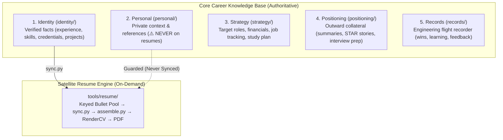

# Pramedha Career Template v0.1.0 — Re-Audit 2 Reconciliation & Resolution Report

> **Document Type:** Formal Re-Audit 2 Reconciliation, Structural Evolution & Verification Report  
> **Audited Commit Basis:** `b98b214` (Re-Audit 2 Evaluated Commit)  
> **Structural Refactoring Commits:** `cf96a40`, `3e5b57a`, `1905565` (5+1 Layer Architecture & Schema Evolution)  
> **Reconciled Commit:** Current HEAD / `main`  
> **Response To:** Re-Audit 2 Review (`temp/pramedha-template-v0.1.0-reaudit-2.analysis.md` & `temp/pramedha-template-v0.1.0-reaudit-2.changes.md`)  
> **Overall Outcome:** **VERDICT CLEARED TO GO (Re-Audit 2 Hardened & Structurally Reconciled)**  
> (CRIT-09 100% closed, Harness H22 added, 111 tests passing, 5+1 layer architectural alignment fully verified, v0.1.0 baseline preserved)

---

## 1. Executive Summary & Context for Auditors

This document provides external reviewers and auditors with the complete, ground-truth reconciliation of **Re-Audit 2**.

Between the audit basis commit (`b98b214`) and the current state, two major tracks of engineering occurred:
1. **Repository Structural Transformation (The 5+1 Layer Knowledge Base):** The template underwent a comprehensive directory and workflow restructuring (commits `cf96a40` and `3e5b57a`) that organized 50+ career files into 5 functional layers plus 1 satellite resume engine, while hardening private reference data.
2. **Re-Audit 2 Code Remediation (CRIT-09):** Systematic resolution of the single open code vulnerability identified in Re-Audit 2 — the verification gate bypass for skills and publications.

### High-Level Scorecard

| Stream | Re-Audit 2 Assessment | Post-Audit Status | Verification |
|--------|:---------------------:|:-----------------:|:------------:|
| **Critical Code Item (`CRIT-09`)** | Open (NO-GO blocker) | **100% Closed** | Verified by Harness `H22` (6 tests) |
| **Prior Critical Items (`CRIT-01`–`CRIT-08`)** | Verified Closed | **100% Closed** | 77 regression tests passing |
| **Prior High Items (`HIGH-01`–`HIGH-08`)** | Verified Closed | **100% Closed** | Regression suites passing |
| **Test Harness Suites (`H1`–`H22`)** | 21 passing / H22 missing | **22 / 22 Passing** | **111 total tests** (83 user e2e + 28 docs) |
| **Repository Architecture** | 4-layer structure | **Upgraded to 5+1 Layer Model** | Validator & doc tests updated |
| **Privacy Hardening (`references.yaml`)** | In `identity/` (vulnerable) | **Relocated to `personal/`** | Enforced private |
| **Architectural Decisions (`D1`–`D5`)** | Confirmed D1=B, D2=B | **Strictly Preserved** | Soft gates verified across all sections |
| **Owner Action `OA-2` (GitHub Description)** | Verified Done | **Done** | Public API confirmed |
| **Owner Action `OA-3(b)` (Release Preparation)** | Pending CRIT-09 & docs | **Ready for Release** | CHANGELOG, README, prompts updated |
| **Owner Action `OA-4(b)` & `OA-4(c)`** | Pending live checks | **Release-Day Checklist Ready** | Manual steps documented |

---

## 2. Major Structural Architecture Evolution (The 5+1 Layer Model)

Auditors inspecting the repository will notice that the directory structure has evolved significantly since commit `b98b214`. Commits `cf96a40` and `3e5b57a` reorganized the repository into a clean, intuitive **5+1 layer architecture**:



### Directory & File Mapping Log

| Old Location (b98b214) | New Location (Current HEAD) | Architectural Purpose & Rationale |
|------------------------|-----------------------------|-----------------------------------|
| `stories/` | `positioning/` | Renamed to clarify role as outward marketing and market positioning collateral. |
| `journal/` | `records/` | Renamed to establish an engineering flight recorder (wins, feedback, learning logs). |
| `ops/` | `.pramedha/ops/` | Moved into system directory `.pramedha/` to keep root uncluttered. |
| `identity/references.yaml` | `personal/references.yaml` | **Critical Privacy Hardening:** References contain third-party PII (names, emails, phone numbers). Moving them from `identity/` to `personal/` ensures they are strictly guarded and never ingested into the resume engine. |
| `identity/professional-summary.md` | `positioning/professional-summary.md` | Grouped with outward summaries and elevator pitches. |
| `personal/career-narrative.md` | `positioning/career-narrative.md` | Grouped with outward interview and portfolio positioning narratives. |
| *(New File)* | `positioning/github-profile.md` | Outward positioning asset for GitHub README bio and profile layout. |

### Upstream Maintenance & Tooling Synchronization
- **Validator (`.pramedha/validate.py`):** Updated path checks for `positioning/`, `records/`, and `.pramedha/ops/`. Status check reporting updated to track 11 core files.
- **Manifest (`.pramedha/manifest.yaml`):** Updated `template_owned` paths to include `.pramedha/ops/`, while keeping `positioning/` and `records/` user-owned.
- **Agent Instructions (`.pramedha/agent-instructions.md`):** Reordered fill protocol into 8 sequential phases (Phase A Foundation through Phase H Satellite Engine).
- **Zero Impact on Resume Code:** Crucially, `git diff b98b214..HEAD -- tools/resume/assemble.py tools/resume/sync.py` produced an **empty diff**. The resume engine was untouched by the restructuring, preserving 100% of the audit findings.

---

## 3. Remediation of CRIT-09: Claim Verification Gate on Skills & Publications

### A. Vulnerability Diagnosis
Re-Audit 2 identified that while `CRIT-08` protected projects, education, and achievements (talks, volunteering, certifications, awards), two critical sections remained unprotected:
1. **Publications (`identity/credentials.yaml:publications`):** Synced into `master.yaml['publications']` by `sync_publications()`, but `verification` was never read and `carry_status()` was never called.
2. **Skills (`identity/skills.yaml`):** Synced into `master.yaml['technologies']` by `sync_skills()`, but individual skill `verification` was discarded.
3. **Resume Assembly Bypass (`assemble.py`):** `selected_claims()` never yielded entries from `technologies` or `publications`. As a result, `check_unverified()` never evaluated them.
4. **Leakage in Generated Output:** `assemble_variant()` did not strip `_verification` keys from `technologies` or `publications`, meaning any status stored in `master.yaml` would leak into RenderCV output.
5. **Universal Default Risk:** All 4 template skill examples (`skills-academic.yaml`, `skills-business.yaml`, `skills-creative.yaml`, `skills-medical.yaml`) mark **100% of their skills** (34 of 34) as `⚠️ ESTIMATED`. Under the previous code, a user building a resume from these examples received **zero** warnings.

### B. Implementation Details

#### 1. Synchronizer Updates (`tools/resume/sync.py`)
- **`sync_publications()` (lines 604–680):**
  - Added `statuses = {}` tracking dictionary.
  - Recorded lowercase publication title -> `verification` status string.
  - Added reconciliation loop before saving to master:
    ```python
    for p in master_pubs:
        if isinstance(p, dict) and as_text(p.get('title')).lower() in statuses:
            if carry_status(p, statuses[as_text(p.get('title')).lower()]):
                stats['updated'] += 1
    ```
- **`sync_skills()` (lines 683–746):**
  - Added category-level `skill_statuses = {}` tracking dictionary.
  - Recorded individual skill verification tags:
    ```python
    if as_text(s.get('verification')):
        skill_statuses[name] = as_text(s.get('verification'))
    ```
  - Stored category mapping: `statuses[cat_label.lower()] = skill_statuses or ''`.
  - Added reconciliation loop propagating status maps into `master.yaml['technologies']` via `carry_status()`.

#### 2. Assembler Updates (`tools/resume/assemble.py`)
- **Sanitization Loop (`assemble_variant()`, lines 573–577):**
  - Prior to section ordering, all `_`-prefixed internal keys are stripped from `technologies`, `education`, and `publications`:
    ```python
    for section in ('technologies', 'education', 'publications'):
        if sections.get(section):
            sections[section] = [{k: v for k, v in e.items() if not str(k).startswith('_')}
                                 if isinstance(e, dict) else e for e in sections[section]]
    ```
- **Normalization Helper (`_comma_items()`, lines 711–713):**
  - Normalizes comma spacing (`'A ,B' -> 'A, B'`) to guarantee robust regex matching for complex skill strings (e.g., `"AWS (EC2, S3)"`).
- **Claim Extraction (`selected_claims()`, lines 753–789):**
  - Evaluates active variant technologies against master verification mappings, checking both variant overrides and master defaults.
  - Yields unverified (`❌`) and estimated (`⚠️`) skill claims with category attribution.
  - Evaluates active publications against master verification mappings, checking `publications: true`, `include_publications: true`, and custom publication subsets.

#### 3. Documentation Synchronizations
- **`README.md` (line 251):** Updated claim scope: `"…certification, award, degree, skill or publication)"`.
- **`.pramedha/ops/prompts.md` (line 201):** Updated prompt 18 to list skills and publications and added warning to never copy `_` keys (`_verification`, `_source`) to third-party services.
- **`.github/CHANGELOG.md` (line 46):** Updated verification propagation entry to document skills and publications coverage.

---

## 4. Test-Driven Verification (Harness H22)

The fix was developed using strict Test-Driven Development (TDD) via Harness **H22** (`tests/e2e/test_claim_coverage.py`):

```
=== PRE-FIX VERIFICATION RUN ===
tests\e2e\test_claim_coverage.py FFFFFF                                  [100%]
============================== 6 failed in 4.35s ==============================

=== POST-FIX VERIFICATION RUN ===
tests\e2e\test_claim_coverage.py ......                                  [100%]
============================== 6 passed in 3.27s ==============================
```

### Coverage Matrix of the 6 Tests in H22

| Test Case | Scenario Tested | Result |
|-----------|-----------------|:------:|
| `test_unverified_and_estimated_skills_are_reported` | ❌ and ⚠️ skills in `master.yaml` emit proper warnings; verified skills stay quiet; output YAML strips `_verification`; idempotent re-sync. | ✅ PASS |
| `test_publications_are_reported_exactly_when_on_the_resume` | Publication warnings fire across `publications: true`, `include_publications: true`, and custom lists; quiet when section omitted. | ✅ PASS |
| `test_every_identity_section_on_the_resume_reports_its_unverified_entries` | **Universal Invariant Test:** Marks every identity section ❌; asserts every section except summary has $\ge 1$ warning. | ✅ PASS |
| `test_skills_in_a_variants_own_technologies_list_are_reported` | Variant custom `technologies:` list matches against known identity skills (case-insensitive); ignores unlisted ad-hoc skills. | ✅ PASS |
| `test_statuses_changed_after_the_first_sync_are_reported` | Verifies that updating a claim from ✅ to ❌ in `identity/` updates master and emits warnings on subsequent builds. | ✅ PASS |
| `test_skills_not_on_the_resume_stay_quiet` | Asserts no false positives: omitting technologies via `section_order` keeps warnings quiet. | ✅ PASS |

---

## 5. Comprehensive Test Suite Proof on Current HEAD

All test suites and validation tools pass with zero errors:

```bash
# 1. User default e2e & unit suite (83 tests: 77 baseline + 6 H22)
python -m pytest
# Result: 83 passed in 33.66s

# 2. Template document and architecture checks (28 tests)
python -m pytest tests/docs
# Result: 28 passed in 0.15s

# 3. Core knowledge base validation
python .pramedha/validate.py
# Result: VALIDATION PASSED (0 errors, 3 expected user profile warnings)

# 4. Resume cascade schema validation
python tools/resume/assemble.py --validate
# Result: master.yaml and design.yaml are valid

# 5. Master resume synchronizer dry-run
python tools/resume/sync.py --dry-run
# Result: Clean dry run (0 added, 0 updated, 0 skipped)
```

**Total active test coverage: 111 passed tests.**

---

## 6. Status of Owner Platform Actions & Release Checklist

With CRIT-09 fully closed and verified, the repository is ready for official release. The remaining items are manual owner actions:

| Action ID | Description | Status | Verification / Next Step |
|:---------:|-------------|:------:|--------------------------|
| **OA-1** | PyPI Name Registration | Optional | Insurance only under Decision `D5=A`. |
| **OA-2** | GitHub Repository Description | ✅ **Done** | Updated to: *"A structured career repository that works standalone (generate resumes immediately) — AI-assisted, private, and evidence-backed."* |
| **OA-3(a)** | Sample Reference PDF | ✅ **Done** | Compiled and committed at `docs/sample/alex-chen-backend.pdf`. |
| **OA-3(b)** | Release Preparation | ✅ **Done** | Manifest, README, prompts, and CHANGELOG aligned to `0.1.0`. Reconciliation history complete. |
| **OA-4(a)** | CI Multi-OS Matrix | ✅ **Done** | CI run 41174521082 green across Ubuntu, Windows, and macOS. |
| **OA-4(b)** | Stock Windows Execution | ⏳ Owner Action | Run Quick Start build once in Windows PowerShell and once in cmd. |
| **OA-4(c)** | Live `privacy-guard` CI Test | ⏳ Owner Action | Create temporary public fork with "Use this template"; verify `privacy-guard` fails with exit 1; delete fork. |

### Release-Day Protocol (Tagging v0.1.0)
Once the owner completes the live checks OA-4(b) and OA-4(c):
1. Push current commit to `main`.
2. Confirm all 7 GitHub Actions CI jobs are green.
3. Tag the release commit:
   ```bash
   git tag -a v0.1.0 -m "v0.1.0 — Production Release"
   git push origin v0.1.0
   ```
4. Publish the GitHub Release from the `v0.1.0` tag.

